

<picture><source media="(prefers-color-scheme: dark)" srcset="assets/hero-dark.svg"></picture>

<picture><source media="(prefers-color-scheme: dark)" srcset="assets/about-dark.svg"></picture>

<picture><source media="(prefers-color-scheme: dark)" srcset="assets/stack-dark.svg"></picture>

<a href="https://github.com/Panagiotissarr/site"><picture><source media="(prefers-color-scheme: dark)" srcset="assets/project-site-dark.svg"></picture></a>&nbsp;<a href="https://github.com/Panagiotissarr/Cloud"><picture><source media="(prefers-color-scheme: dark)" srcset="assets/project-cloud-dark.svg"></picture></a>

<a href="https://github.com/Panagiotissarr/Scanners"><picture><source media="(prefers-color-scheme: dark)" srcset="assets/project-scanners-dark.svg"></picture></a>&nbsp;<a href="https://github.com/Panagiotissarr/bibata"><picture><source media="(prefers-color-scheme: dark)" srcset="assets/project-bibata-dark.svg"></picture></a>

<a href="https://github.com/Panagiotissarr/obby-v2"><picture><source media="(prefers-color-scheme: dark)" srcset="assets/project-obby-v2-dark.svg"></picture></a>&nbsp;<a href="https://github.com/Panagiotissarr/Files"><picture><source media="(prefers-color-scheme: dark)" srcset="assets/project-files-dark.svg"></picture></a>

<picture><source media="(prefers-color-scheme: dark)" srcset="assets/stats-dark.svg"></picture>

<picture><source media="(prefers-color-scheme: dark)" srcset="assets/streak-dark.svg"></picture>

<picture><source media="(prefers-color-scheme: dark)" srcset="assets/wave-dark.svg"></picture>

<a href="https://sarris.dev"><picture><source media="(prefers-color-scheme: dark)" srcset="assets/button-1-dark.svg"></picture></a>&nbsp;&nbsp;<a href="https://github.com/Panagiotissarr?tab=repositories"><picture><source media="(prefers-color-scheme: dark)" srcset="assets/button-2-dark.svg"></picture></a>

<a href="https://metawka.github.io/expressive-profile/?from=Panagiotissarr"><picture><source media="(prefers-color-scheme: dark)" srcset="assets/credit-dark.svg"></picture></a>

